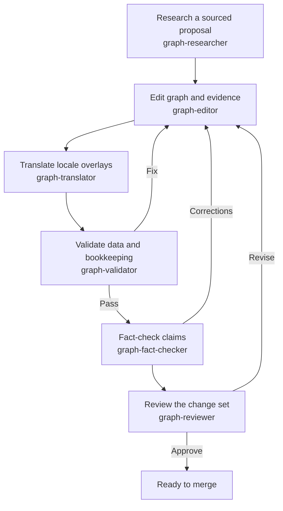
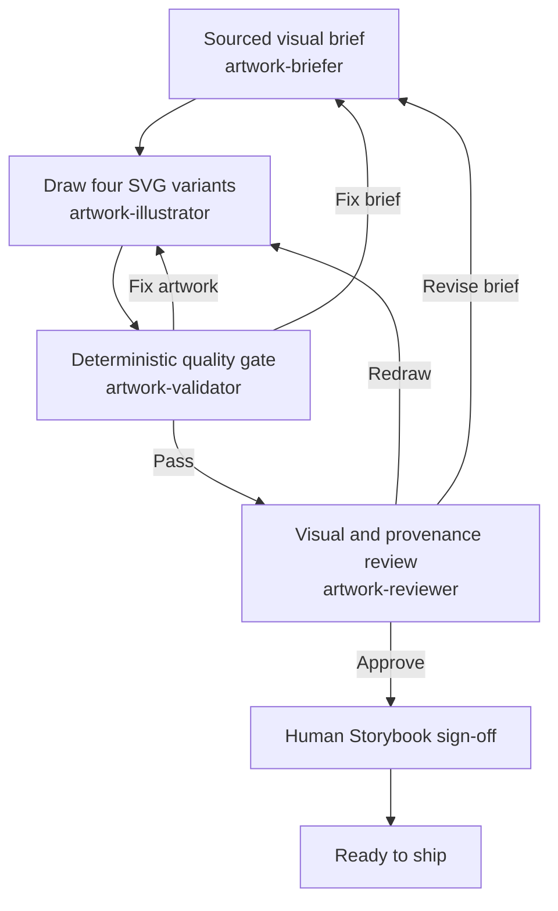
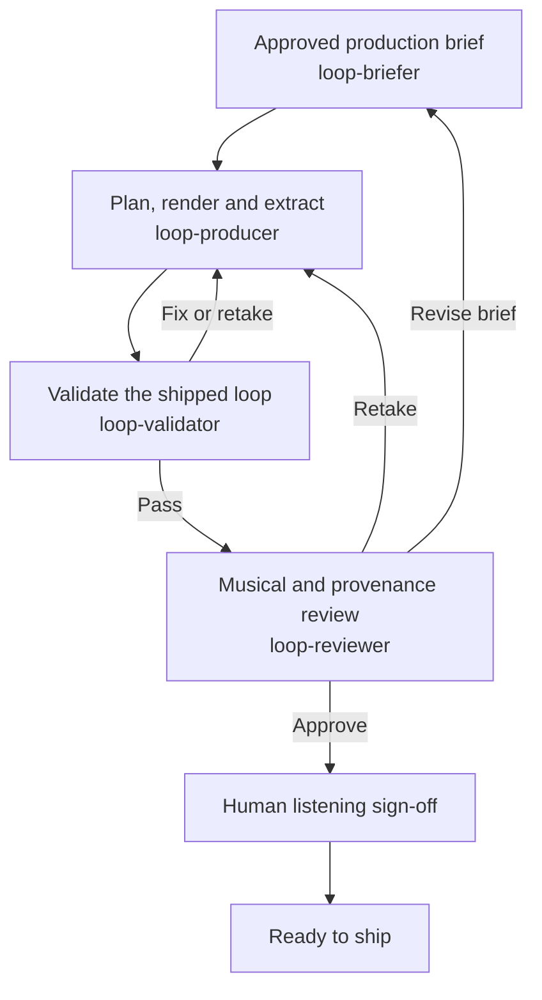
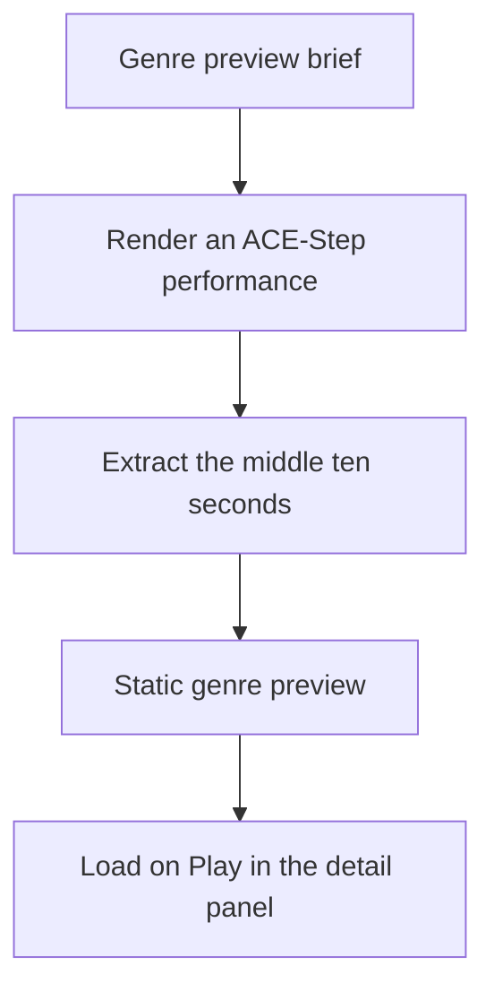

<p align="center">
  
</p>

<h1 align="center">Soundlines</h1>

<p align="center">
  <strong>Music history, connected.</strong><br />
  A chronological map of music and the lineages that connect it.
</p>

<p align="center">
  <a href="#explore-music-history">Features</a> ·
  <a href="#getting-started">Get started</a> ·
  <a href="#documentation">Docs</a> ·
  <a href="https://alexandrehebert.github.io/soundlines/">Project guide</a> ·
  <a href="#credits">Credits</a> ·
  <a href="#license">License</a>
</p>

Soundlines is a clean rebuild of the `music-tree` project, exploring genres,
artists, instruments, labels, scenes, and historical events.

Built with Next.js App Router, React 19, TypeScript, Tailwind CSS 4, and Motion.
Tested with Vitest, linted with oxlint, and deployable to Vercel.

## Explore music history

- Browse **Genres**, **Artists**, and **Instruments** on interactive timelines,
  or explore genre lineages in the bubble map.
- Discover curated events in the **History** view.
- Search the catalogue, follow relationships, and inspect sources in detail panels.
- Share a view or selection through its URL.
- Listen to genre previews and play or scratch the landing-page vinyl loop.
- Switch between English and French, and dark and light themes.

The catalogue is curated, not exhaustive. Dates, relationships, and prominence
phases include sourced editorial judgments; they are not popularity rankings.

## Getting started

For tool installation, agent/skill setup, and optional artwork and audio
environments, see the [installation guide](./docs/INSTALLATION.md).

Use Node.js 26, as specified in [package.json](./package.json).

```bash
npm ci
npm run dev
```

Open the local URL printed by Next.js. Alternatively, run the app and Storybook
with Docker Compose:

```bash
docker compose up -d
```

Compose serves the app at `http://localhost:5173` and Storybook at
`http://localhost:6008`. See the [development guide](./docs/DEVELOPMENT.md) for
server reuse, port overrides, and Storybook details.

For the optional standalone ACE-Step rendering dashboard, see
[ACE Monitor](./tools/ace-monitor/README.md). It runs in its own Compose stack at
`http://localhost:5180`, without changing the Soundlines app or ACE server.

## Common commands

```bash
npm test                # test suite
npm run lint           # lint
npm run build          # production build
npm run start          # serve the production build
npm run storybook      # component catalogue
npm run validate:graph # graph validation
```

## Workflows

Expand a workflow for its stages and owners. These are contributor processes,
not services required to run the app.

The graph, artwork, and loop workflows describe this repository's
AI-assisted contribution system: reusable **skills** give an AI coding
assistant project-specific procedures, and specialized **agents** take
responsibility for individual stages and handoffs. They guide work when
invoked; they are not automatic pipelines. Deterministic validation and the
human review or sign-off shown in each diagram remain explicit gates. Genre
previews use dedicated `preview-briefer`, `preview-producer`, and `preview-reviewer` agents
with the existing preview renderer, automated quality scoring and staged retake comparison.

<details>
<summary><strong>Music graph</strong> — research, enrichment, and source review</summary>



The editor keeps the graph, translations, evidence, and generated review status
in sync. See the [graph contribution guide](./docs/DATA.md#graph-contribution-workflow)
and [schema guide](./docs/GRAPH.md).

</details>

<details>
<summary><strong>Instrument artwork</strong> — references to four SVG variants</summary>



See the [instrument artwork guide](./docs/DATA.md#instrument-artwork).

</details>

<details>
<summary><strong>Audio loops</strong> — genre briefs to seamless recordings</summary>



Production also screens raw takes before extraction. See the
[audio guide](./docs/AUDIO.md) and [loop production procedure](./.github/skills/loop-produce/SKILL.md).

</details>

<details>
<summary><strong>Genre previews</strong> — short clips for the detail panel</summary>



Previews use a separate renderer, not the seamless-loop pipeline. See the
[preview generation guide](./docs/AUDIO.md#genre-previews).

</details>

## Documentation

The [project companion](https://alexandrehebert.github.io/soundlines/) presents
Soundlines and its graph, artwork, audio, and contribution workflows in
[English](https://alexandrehebert.github.io/soundlines/en/) and
[French](https://alexandrehebert.github.io/soundlines/fr/).
It is a curated introduction; the guides below remain the detailed technical reference.
See [GitHub Pages setup](./docs/DEVELOPMENT.md#project-companion-github-pages)
for publishing and editing the companion.

| Guide | Contents |
|---|---|
| [Installation](./docs/INSTALLATION.md) | Required and optional tools, agent/skill setup, local development, artwork, audio, and integrations |
| [Explorer behavior](./docs/EXPLORER.md) | Views, navigation, gestures, loading transitions, dates, and prominence rendering |
| [Audio](./docs/AUDIO.md) | Landing loop provenance, genre previews, and local generation |
| [Data and contribution workflow](./docs/DATA.md) | Dataset scope, evidence, graph editing, and instrument artwork |
| [Graph schema and editing guide](./docs/GRAPH.md) | Canonical schema, validation rules, and enrichment guidance |
| [Architecture](./docs/ARCHITECTURE.md) | Routing, state, themes, localization, metadata, and rendering modules |
| [Development](./docs/DEVELOPMENT.md) | Commands, Docker Compose, Storybook, and deployment notes |

The canonical dataset is [graph.json](./src/data/graph.json); research and audits
live in [docs/graph/evidence](./docs/graph/evidence). Tooling is documented in
[docs/SCRIPTS.md](./docs/SCRIPTS.md).

## Credits

- Created by [Alexandre “Axoune” Hebert](https://github.com/alexandrehebert).
- The vinyl logo is adapted from [Lucide's Disc 3 icon](https://lucide.dev/icons/disc-3)
  (ISC license); the full notice is in [favicon.svg](./public/favicon.svg).
- The landing loop and genre previews were generated with
  [ACE-Step 1.5](https://github.com/ace-step/ACE-Step-1.5). See the
  [audio guide](./docs/AUDIO.md) for details.
- Music history sources are linked in the app and documented in the
  [evidence notes](./docs/graph/evidence).

## License

Unless otherwise noted, original work in this project is licensed under the
[Apache License 2.0](./LICENSE). You may reuse and modify it, including for
commercial purposes, provided you follow its terms, including retaining the
license and attribution notices and marking modified files. See [NOTICE](./NOTICE)
for the copyright holder and third-party material. Apache-2.0 does not grant
permission to use the Soundlines name or marks as a trademark; third-party assets
keep their own licenses.
